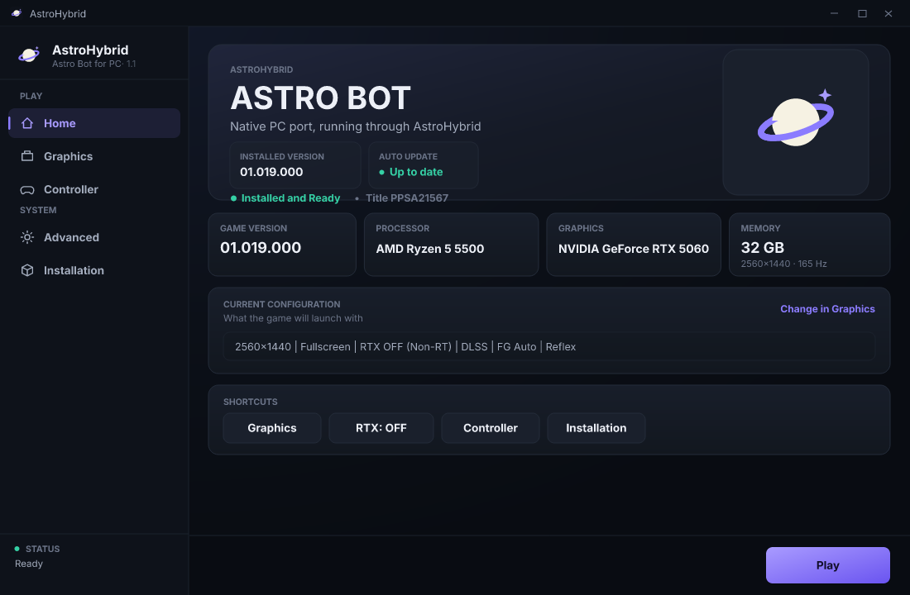
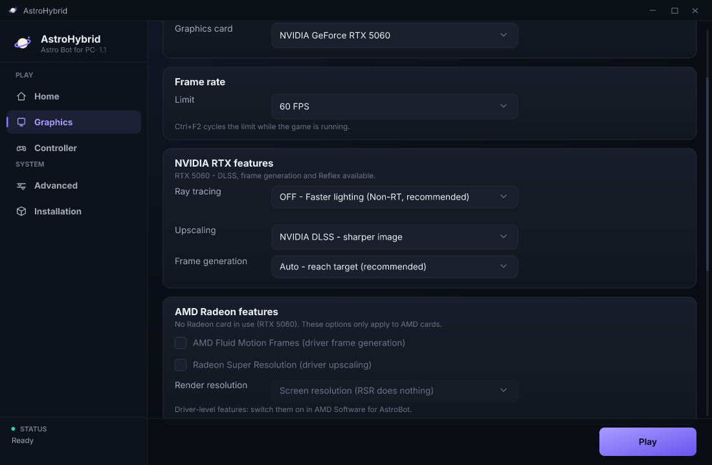
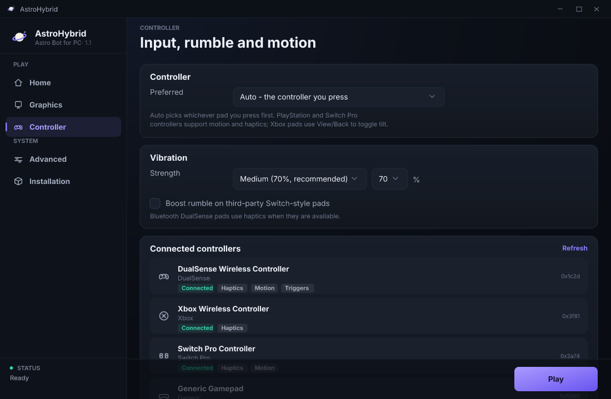
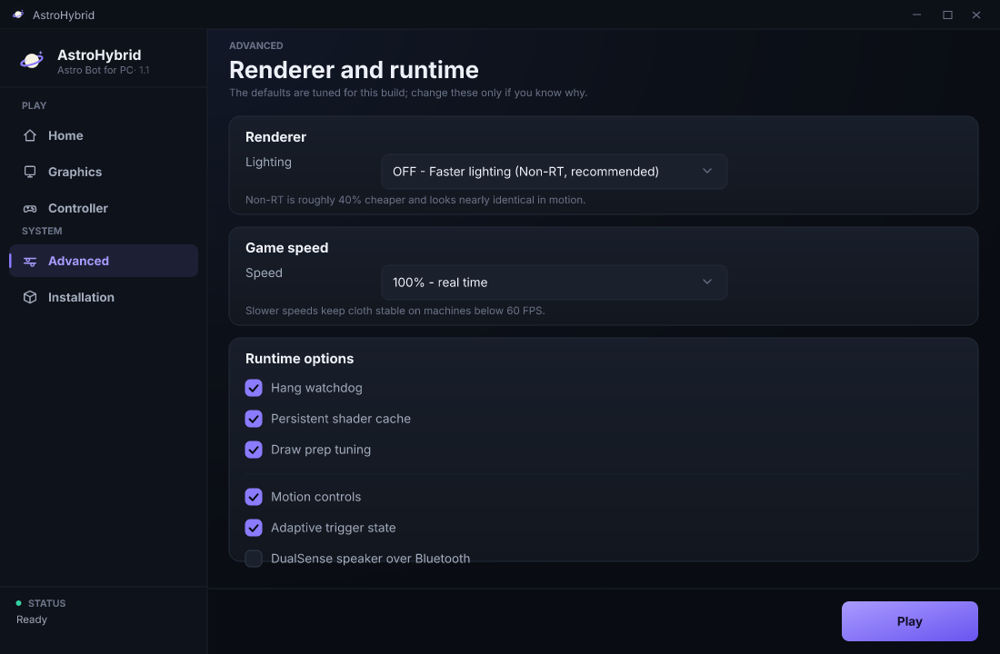
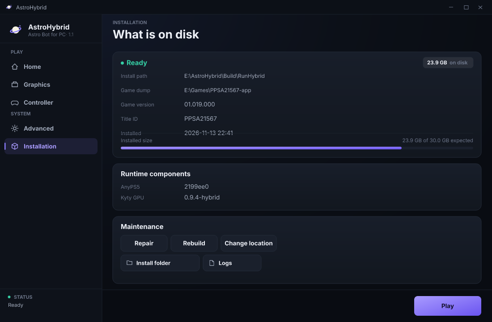

# Astro Bot native PC port (AstroHybrid): DLSS Frame Generation, Reflex, any controller

A personal research project: running my own legally owned PS5 copy of **Astro Bot** (PPSA21567, v01.019.000)
natively on Windows, with NVIDIA DLSS Super Resolution, DLSS (Multi) Frame Generation and Reflex added on top.

**No game files are in this repository or in the download**, and none will be: no game executable, assets,
shaders, keys, saves or game artwork. You need your own decrypted dump of the game; the setup converts it on your PC.

## Download and play

1. Download the **AstroBotPC-AstroHybrid** zip from the [latest release](https://github.com/imnotsharingmyname/pcportastrobot/releases/latest)
   and extract it anywhere with about 1 GB free (the game itself stays where your dump is).
2. Start **AstroHybrid.exe**. Setup asks for your Astro Bot dump folder (Browse, or paste the path and press Check folder, then Install) (the one with `eboot.bin`, `sce_module`,
   `sce_sys`) and builds the Windows version of the game from it in about two minutes. Your dump is only read.
3. The app picks the best settings for your PC once (graphics card, CPU, RAM, display); change anything on the
   Graphics, Controller and Advanced pages.
4. Press **Play**.

The download is the same build as the development PC: the same PS5 system libraries, `kyty_gpu.dll` (DLSS,
frame generation, Reflex, controller fixes), the same launcher settings, and setup makes the same `AstroBot.exe`
byte for byte from a 01.019.000 dump. Other Astro Bot versions are accepted: the faster-lighting patch and
real-time game speed switch themselves off when that version's code differs (they depend on exact code
locations); everything else works the same way. Only 01.019.000 has been tested.

Requirements: Windows 10/11 x64, a Vulkan GPU; DLSS needs an RTX card, frame generation an RTX 40 or 50. The
[CPU and GPU table](#which-cpu-and-gpu-gets-you-what) below says what each tier actually runs at.
Controllers: DualSense, DualShock 4, Xbox, Switch Pro and compatible pads, generic pads (the one you press plays).
Command line: `AstroHybrid.exe --setup "<dump folder>"` runs the setup without a window; `--remove-game` removes
what setup built.

### Screenshots

| Home | Graphics |
|---|---|
|  |  |
| **Controller** | **Advanced** |
|  |  |
| **Installation** | |
|  | |

The images are rendered from the launcher's XAML (`Tools/brand/render_screenshots.js`) so they match
the shipped layout; see [Docs/LAUNCHER_UI.md](Docs/LAUNCHER_UI.md).

## What it is

This is **not an emulator**. It is a native port:

- **AnyPS5** relinks the game's own x86-64 code into a Windows `.exe` (`AstroBot.exe`). The PS5 system
  libraries (kernel, libc, pad, audio, save data and so on) are reimplemented natively as Windows modules.
- **AstroHybrid**: the PS5 GPU side (AGC command buffers, shaders, VideoOut) is handled by a GPU stack taken from
  KytyPS5 and built as `kyty_gpu.dll`. It translates the GPU work to Vulkan and is loaded by the native exe.
- **NVIDIA RTX layer** (new): the game's own temporal upscale pass is found at run time and its inputs (colour,
  depth, motion vectors, jitter, camera matrices) are handed to DLSS and to DLSS Frame Generation through
  NVIDIA Streamline 2.14.16 on Vulkan.

## Benchmarks (real measurements, one PC)

Ryzen 5 5500 (6 cores / 12 threads), RTX 5060 8 GB, 32 GB RAM, 2560x1440 165 Hz, NVIDIA driver 621.

| What | Result |
|---|---|
| Sky Garden (heaviest area found), game's own frame rate | **32-34 FPS** uncapped; a 30 FPS cap holds in every 10 s window |
| Other levels (start positions) | Hoover beach 51-53, snowy canyon 43-44, Cymbal party land 37-39 FPS |
| Frame Generation 2x (window focused) | exactly 2.00 frames shown per game frame, about **63 FPS on screen** |
| Multi Frame Generation 4x | exactly 4.00 per game frame, about **124-128 FPS on screen** |
| Adaptive Frame Generation (target 60) | game held at 24 FPS: switches itself to 3x = 72 on screen; game at 30: 2x = 60 |
| "Faster CPU path" (commit epoch fast path) | about 0.3 us less per continued draw, roughly **1 ms of command-processor time per frame**; verify mode: 0 mismatches |
| Real-time game speed | the game ran at 0.50x speed when capped at 30 FPS; now **0.98x** real time |
| DLSS Super Resolution | runs every frame on the game's 1920x1080 -> 2432x1368 upscale pass, picture correct |

Where the time goes: a 30 ms frame is about 22 ms of draw commit on one CPU thread (about 4,900 draws a frame),
so the game is **CPU-limited**; the GPU has headroom. That is why Frame Generation is the main smoothing tool
here, and why lowering the resolution does not raise the frame rate.

Tried and rejected (measured): AVX2 build of the GPU DLL (no difference), write-fault window and lock-spin
tuning (within noise), Lossless Scaling x2 (stutter and input lag), AnyPS5's own renderer instead of Kyty's
(does not boot). Every result, good or bad, is in `Docs/OVERNIGHT.md`.

Caveat: numbers move with background load. With a browser playing audio the same 30 FPS-capped scene read
22-25 FPS in one evening session, so compare runs on a quiet machine.

## Which CPU and GPU gets you what

The **Tune for this PC** button (called "Best settings for this PC" in the older launcher) reads your card's
RTX generation and your display's resolution and refresh rate, and nothing else. CPU and RAM are detected and
shown but never change a setting. These tables make that logic visible, and add the one thing it cannot know:
how fast the result will actually run.

**Read this first.** The project has been benchmarked on exactly one PC (the one in the section above). Its CPU
is the ceiling: 30-34 FPS in the heaviest area, and more GPU does not move that number. So a bigger card
buys you *smoother output at the same game speed* through Frame Generation, not a higher game rate.

- **measured**: run on that PC, listed in `Docs/PERFORMANCE.md`.
- *arithmetic*: a multiplication of a measured number (frames on screen = game frames x multiplier), not a run.
- *est.*: guessed from how a frame is spent, not from a benchmark on that hardware.
- **reported**: sent in by another tester.

### GPU: what the card gets you

| Tier (minimum card) | VRAM | Game's own FPS, heavy area | Upscaling | Frame Gen | On screen | Verdict |
|---|---|---|---|---|---|---|
| RTX 50 on a 120 Hz+ display | 8 GB | 32-34 **measured** | DLSS | Auto to 120, picks 4x | 124-128 **measured** | **Showcase.** This is the machine this was built on. |
| RTX 50 on a 90 Hz display | 8 GB | 32-34 **measured** | DLSS | Auto to 90, picks 3x | 96-102 *arithmetic* | **Smooth.** Same game rate, three frames shown per one. |
| RTX 50 on a 60 Hz display | 8 GB | 32-34 **measured** | DLSS | Auto to 60, picks 2x | 63 **measured** | **Good.** Measured at 2.00 shown frames per game frame. |
| RTX 40 (4060 and up) | 8 GB | 32-34 *est.* | DLSS | 2x only | 60-68 *arithmetic* | **Good.** Same ceiling as RTX 50, half the smoothness. |
| RTX 30 (3060 and up) | 8 GB | 30-34 *est.* | DLSS | no | same | **Playable.** DLSS and Reflex, the rate the port runs at. |
| RTX 20 (2060 and up) | 6-8 GB | 28-34 *est.* | DLSS | no | same | **Playable.** Oldest tier that gets NVIDIA features at all. |
| GTX 10/16 series, Arc A750/A770 | 6-8 GB | 26-34 *est.* | game's own | no | same | **Playable.** Budget a card with 8 GB; VRAM is the real floor. |
| Radeon RX 7900 / 9070 | 16 GB | 32-34 *est.* | game's own | no | same | **Playable.** Far more GPU than the CPU-limited frame needs. |
| Radeon RX 7600 / 6700 / 6600 | 8 GB | 28-34 *est.* | game's own | no | same | **Playable.** The sensible AMD target; already at the CPU ceiling. |
| Radeon RX 5700 / Vega 56/64 | 8 GB | 24-32 *est.* | game's own | no | same | **Playable, at the edge.** Older drivers, no headroom. |
| Radeon RX 6500 XT / 6400 | 4 GB | below 30 *est.* | game's own | no | same | **Below the floor.** 4 GB of VRAM is the problem, not the chip. |
| Integrated graphics (Iris Xe, Vega 8, 700M/800M) | shared | single digits to mid-teens *est.* | game's own | no | same | **Not playable.** Nothing to turn on that would fix it. |

**AMD cards specifically.** None of the NVIDIA features apply, and the launcher says so instead of half-enabling
them: FSR is not implemented (`HardwareDetector.cs`, "AMD FSR support would go here"), so the
Upscaling and Frame generation menus stay greyed out (`SupportsDlss` is false without an RTX card) and **Tune
for this PC** sets resolution, fullscreen and the 30 FPS cap and nothing else.

What that means in practice: a Radeon card plays the way an RTX 20 or 30 card does, at the game's own rate, with
no smoothing on top. Because the frame is CPU-limited at 30-34 FPS, an RX 6600 and an RX 7900 XTX should land in
much the same place, so there is little reason to buy up for this port. Detection covers the discrete names (`RX` plus
`Pro W`, `FirePro`, `Radeon Pro`); "Radeon(TM) Graphics", Vega 8 and the 700M/800M parts are read as integrated
graphics. All of this is *est.*: the project has never run on an AMD card, and the only Vulkan driver tested is
NVIDIA 32.0.16.2101.

### AMD features: what the Radeon card gets instead

The Graphics page has an **AMD Radeon features** card next to the NVIDIA one. It covers the two things AMD offers
that matter for a 30 FPS port, both of them driver features rather than game features, so the launcher cannot
switch them on: it puts the game in the state they need and tells you which switch to flip in AMD Software
(Adrenalin) for `AstroBot.exe`.

| Feature | What it does | What it needs | Launcher sets | You switch on |
|---|---|---|---|---|
| **AMD Fluid Motion Frames** (AFMF) | Driver frame generation, like Frame Generation but in the driver: interpolates extra frames in any DX11/DX12/Vulkan/OpenGL game, so no game support is needed | Radeon RX 6000 or 7000 desktop; Adrenalin 25.3.1+; Vulkan is supported from AFMF 2 on | Fullscreen, VSync off, no FPS cap (30 / 60 x 2 = 120 on screen) | Adrenalin **Gaming → Games → AstroBot → Fluid Motion Frames** |
| **Radeon Super Resolution** (RSR) | Driver upscaling: FSR1 in the driver, scaling whatever the game renders up to the screen | Radeon RX 5000 or newer; the game must render below the screen's resolution | A render resolution below the screen (720p / 900p / 1080p), windowed | Adrenalin **Gaming → Games → AstroBot → Radeon Super Resolution → Enabled - Borderless Fullscreen** |
| **Radeon Anti-Lag** | Shortens the CPU→GPU queue, AMD's answer to Reflex | Radeon RX 5000 or newer | nothing | Adrenalin, per game |
| **Image Sharpening** | Sharpens the upscaled picture | any Radeon | nothing | Adrenalin, per game |

**Read the catch before turning AFMF on.** AMD's own guidance is a base rate of about 55 FPS at 1080p and 70 FPS at
1440p, because driver interpolation has no motion vectors to work with and the lower the real rate, the more it
smears and lags. This port renders **30-34 FPS**. AFMF does not raise the game's own rate, so a 30 FPS scene becomes
60 *shown* frames with 30 FPS input, and the extra lag is the part you feel. It is worth a try; it is not the fix
that Frame Generation is on an RTX 40/50 card, and no one has reported trying it on this port.

Two more honest limits: the RX 6000 generation only gets AFMF in **exclusive** fullscreen while RX 7000 also
accepts borderless, and this port's window mode is SDL's fullscreen desktop window, so on a 6000 card AFMF may
simply show *Inactive* in the Adrenalin overlay. And AFMF needs VSync off, which is why the launcher turns the
VSync option off when you tick it: a FreeSync display is the better answer for tearing there.

The AMD card is greyed out on an NVIDIA machine, and turning on DLSS or NVIDIA frame generation turns the AMD
equivalents off (and the reverse), since stacking two upscalers or two frame generators is not something either
vendor supports. Everything here is untested on AMD hardware, like the rest of the AMD rows above.

One **reported** machine sits outside this table: an RTX 4050 laptop with an i7-13700HX read 15-16 FPS on the
title screen with heavy queue lag in game (AnyPS5 discussion #11917). A 4050 is the bottom of the RTX 40 range
and a laptop part, so read the RTX 40 row as desktop cards.

Resolution is picked for you too: the largest of 1280x720, 1600x900, 1920x1080 and 2560x1440 that fits your
display, started fullscreen.

The 8 GB floor is not about speed: with a 4K output buffer the game peaked at 6.5 of the card's 7.0 GB
during a cutscene, and the one community tweak that got close to 30 FPS on a 12 GB card (a 2.8 GB texture
cache) does not fit in 8 GB. Resolution barely matters on the measured PC because it is CPU-limited; memory
does.

### CPU: the ceiling that matters more

| CPU (minimum) | Native FPS, heavy area | Notes |
|---|---|---|
| Ryzen 5 5500 / 6 cores, 12 threads, Zen 3 | 30-34 **measured** | The reference machine. Reaches 43-44 in a snowy canyon, 51-53 on a beach. |
| 8 cores / 16 threads, Zen 4 or Intel 13th gen and up | 30-36 *est.* | A few frames, not a generation. The frame is latency, not throughput. |
| 4 cores / 8 threads, Zen 2 or Intel 8th-10th gen | 24-32 *est.* | Expect to drop under 30 with other programs open. |
| 4 cores / 4 threads, or a laptop U-series chip | 18-28 *est.* | Works, stutters in the busiest areas. |
| 2 cores / 4 threads | not usable *est.* | Setup runs, the game does not keep up. |

Why more cores do not help: the whole process uses 1.5-2.5 of 12 threads, and about 22 ms of a 30 ms frame
is one thread committing ~4,900 draws and waiting on CPU-GPU syncs (roughly 800 pipeline barriers a frame).
`Docs/PERFORMANCE.md` has the breakdown and the runs that tried to move it.

### What each feature needs

| Feature | Needs | Where it is set |
|---|---|---|
| Game's own upscaling | any Vulkan GPU | always |
| DLSS Super Resolution | any RTX card (20 series and newer) | automatic on an RTX card |
| NVIDIA Reflex | any RTX card | automatic with DLSS |
| Frame Generation 2x | RTX 40 or newer | automatic on RTX 40/50 |
| Frame Generation 3x and 4x | RTX 50, up to what the runtime allows | automatic on RTX 50 |
| Auto multiplier to a target | Frame Generation | picks 2x/3x/4x in game every half second |

Frame Generation runs only while the window is focused, and must not be combined with NVIDIA Smooth Motion.
The Streamline and DLSS runtime files are yours to supply (see the section above). The AMD equivalents are in
[AMD features](#amd-features-what-the-radeon-card-gets-instead) above.

### Reading the "on screen" column

Frame Generation does not make the game simulate faster. At 4x the game still renders 30-34 frames a second
and 124-128 are *shown*; input is sampled at the game's rate, and that game rate is why the launcher caps it
at 30 rather than leaving it uncapped. So treat "on screen" as smoothness, not responsiveness. If a tier says
30 on screen, that is the game's real rate.

## What's new in this update

- **DLSS Super Resolution** (`ASTROHYBRID_DLSS=1`). Needed a fix in AnyPS5's libc: CUDA (which DLSS uses) needs
  a 48 GiB address window below 1 TiB, which the PS5 memory map had taken (`ASTROHYBRID_CUDA_HOLE=1`).
- **DLSS Frame Generation and Multi Frame Generation** through Streamline (`ASTROHYBRID_DLSSG=1`,
  2x / 3x / 4x), with an **adaptive mode** that picks the multiplier in game every half second to stay at or
  above a target on screen (`ASTROHYBRID_DLSSG_TARGET`). The game itself is never capped below 30 FPS.
- **NVIDIA Reflex** for Vulkan through `VK_NV_low_latency2` (`ASTROHYBRID_LOW_LATENCY=1`).
- **Cloth and bubble stability** (`KYTY_BUFFER_RANGE_FIXES=1`, `ASTROHYBRID_COMMIT_EPOCH_FASTPATH=0`, plus 60 Hz cloth physics step cap during real-time speed below 60 FPS; issues #30, #35).
- **Performance overlay** shows frames on screen and the game's own rate with Frame Generation.
- **Controllers**: DualSense (rumble, light bar, adaptive triggers, motion), Xbox, Switch Pro and compatible
  pads, generic pads. The pad you press becomes player 1 (before, a second pad got no input), vibration
  strength for non-DualSense pads, a stronger-rumble option for third-party Switch-style pads.
- **Launcher** (`AstroBot Launcher.exe`, source in `Tools/hybrid/launcher`):
  - new NVIDIA RTX section: upscaling, frame generation (Off / Auto / 2x / 3x / 4x), on-screen target, Reflex;
  - new Controls section: controller choice and vibration strength;
  - **"Best settings for this PC"**: reads the graphics card, CPU, RAM and display and fills in everything,
    also on first start. RTX 50: DLSS + Frame Generation Auto (x2-x4) to 120 on a 120 Hz+ display;
    RTX 40: Auto to 60 (x2); RTX 20/30: DLSS + Reflex at a steady 30; others: the game's own upscaling at 30;
  - real-time game speed and the faster CPU path are always on (their checkboxes are gone).

All new behaviour is behind environment switches that are off by default; the launcher turns them on.

### Two graphics cards (laptops)

A laptop with Intel or AMD integrated graphics plus an NVIDIA card (Optimus / hybrid) used to show only the
integrated chip, so the RTX section stayed off. Both launchers now list every adapter, not only the one that
drives the screen:

- **Graphics page → Display → Graphics card**: "Automatic - best graphics card" (default) or a named card.
  DLSS, Frame Generation and Reflex follow the card you pick; picking a non-RTX chip turns them off.
- The renderer itself already prefers a discrete card, so Automatic is right for almost everyone. Pick the
  integrated chip only to compare performance.
- "Best settings for this PC" in the classic launcher now reads the discrete card on these laptops too.

## Requirements for the NVIDIA features

- DLSS Super Resolution and Reflex: any RTX card. Frame Generation: RTX 40 or newer; 3x and 4x: RTX 50.
- The Streamline SDK 2.14.16 and the DLSS runtime, downloaded by you from NVIDIA; the runtime files go next to
  the game (`ASTROHYBRID_DLSS_PATH`). They are not in this repository.
- Frame Generation runs only while the game window is focused. Do not combine it with NVIDIA Smooth Motion.
- Only whole multipliers: NVIDIA's dynamic (fractional) multiplier is D3D12-only.

## Known issues

- Xbox and other pads without motion sensors: the motion hand does not work yet (tilt emulation with
  View/Back + right stick reaches the pad library but the game did not react in the user's test).
- Vibration on third-party Switch Pro pads (for example Data Frog) is not confirmed yet.
- With **no FPS limit and Frame Generation off**, the first loading screen stays black for about 35 s (it
  runs at about 144 FPS and slows the loading threads); capped starts take about 20 s. It is not a hang.
- Input latency with Frame Generation has not been measured. The DLSS jitter sign is set by eye.
- The game is CPU-limited at about 30-34 FPS on a Ryzen 5 5500 in the heaviest areas.

## What is here

| Folder | Contents |
|---|---|
| `Source/patches` | AnyPS5 patch series (native libraries, AstroHybrid host, DualSense input/rumble/triggers/motion, CUDA address window) |
| `Source/hybrid/patches` | KytyPS5 patch series for `kyty_gpu.dll` (frame pacing, real-time speed, fast path, Reflex, DLSS, Frame Generation, overlay, controllers) |
| `Source/game-patches` | Small optional byte patches applied at load time (lighting mode, GI probes, fixed 1080p) |
| `Source/experiments` | Measured experiments that were not kept, with their patches |
| `Tools/hybrid` | Launcher, run-folder builder, Kyty build script, reverse-engineering helpers |
| `Tests` | Benchmarks and A/B test scripts |
| `Docs` | Build instructions, technical plans, reverse-engineering notes, and the full results log (`OVERNIGHT.md`) |
| `Run-AstroHybrid*.bat` | Start scripts: plain, DLSS, Frame Generation |
| `AstroHybrid.App` | The AstroHybrid app (WPF, .NET Framework 4.8): setup from a dump (`Services/GameSetup.cs`, a C# port of AnyPS5's `unwrap_self.py`), settings, best settings for the PC, launch |
| `Tools/release` | `make_release.ps1` builds the download from a working install (with a guard against game files); `make_icon.ps1` draws the app icon (the Python source of the mark is `Tools/brand/make_logo.py`) |

## Status

Work in progress, personal use. Not affiliated with or endorsed by Sony Interactive Entertainment, Team ASOBI
or NVIDIA. Astro Bot is a trademark of its owners; NVIDIA, DLSS and Reflex are trademarks of NVIDIA.
